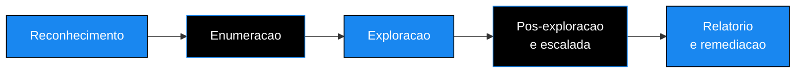

<!-- ══════════════════════ IDIOMAS / LANGUAGES ══════════════════════ -->

<!-- ══════════════════════════ BANNER ══════════════════════════ -->

  

  

  

 

<!-- Cabeçalho animado -->

  

<h1 align="center">Cybersec Portfolio</h1>

<em>Evidência prática de testes de invasão conduzidos em ambientes legais e autorizados, do reconhecimento ao relatório executivo.</em>

 

<!-- ══════════════════════════ NAVEGAÇÃO ══════════════════════════ -->

 

<!-- ══════════════════════════ SOBRE ══════════════════════════ -->

## Sobre este portfólio

Sou Douglas Cshunderlick, engenheiro de software com foco em Segurança Ofensiva / Red Team e AppSec: pentest, defesa de redes e análise de ameaças. Cada pasta deste repositório documenta um comprometimento real, executado em laboratório autorizado (TryHackMe, HackTheBox e ambientes próprios), com a mesma estrutura que eu entregaria a um cliente: prova de conceito, caminho de ataque passo a passo e recomendações priorizadas de correção.

A ideia não é só "capturar a flag". É mostrar como penso uma invasão de ponta a ponta e, principalmente, como traduzo o achado técnico em risco de negócio e em um plano de remediação que a equipe consegue executar.

  

<!-- ══════════════════════════ METODOLOGIA ══════════════════════════ -->

## Como cada teste é conduzido

Todo relatório segue o mesmo fluxo, alinhado ao OSSTMM e ao OWASP Testing Guide. As cinco fases abaixo são clicáveis no índice e aparecem detalhadas em cada caso.

| Fase | O que acontece |
|:--|:--|
| **Reconhecimento** | Mapeamento da superfície exposta, portas e serviços vivos |
| **Enumeração** | Investigação de cada serviço em busca de versão, configuração fraca e credencial |
| **Exploração** | Obtenção do primeiro acesso, com confirmação ativa da falha |
| **Pós-exploração** | Movimentação lateral e escalada até o controle total |
| **Relatório** | Tradução do achado em impacto de negócio e correção priorizada |

  

<!-- ══════════════════════════ RELATÓRIOS ══════════════════════════ -->

## Relatórios de teste de invasão

| Máquina | Plataforma | Dificuldade | Tempo até root | Vetor principal | Status |
|:--|:--:|:--:|:--:|:--|:--:|
| **Internal** | TryHackMe | Difícil | Encadeado | WordPress fraco → Jenkins interno → credencial de root em disco | Concluído |
| **Poster** | TryHackMe | Média | ~1h40 | PostgreSQL com credencial padrão + `CVE-2019-9193` | Concluído |
| **Mr Robot** | TryHackMe | Média | Encadeado | WordPress + wordlist vazada → SUID `nmap` | Concluído |
| **Kenobi** | TryHackMe | Média | Encadeado | Samba anônimo + ProFTPD `CVE-2015-3306` → SUID | Concluído |
| **Basic Pentesting** | TryHackMe | Fácil | Rápido | SSH com senha fraca → SUID `find` | Concluído |
| **Meow** | HackTheBox | Fácil | ~45min | Telnet com login de root direto (Alpine mal configurado) | Concluído |

Clique em cada caso para abrir o resumo do ataque sem sair desta página.

<b>Internal · comprometimento total encadeando WordPress, Jenkins e credenciais em disco</b>

 

> Teste black-box de pré-produção. Partindo só do IP, um WordPress exposto com senha trivial deu o primeiro acesso; a partir dele, credenciais em texto claro espalhadas pelo disco e um Jenkins interno sem isolamento levaram ao root. O fio condutor é a reutilização e o armazenamento de senhas em texto claro.

**Caminho resumido**

1. `gobuster` achou `/wordpress/`; `wpscan` quebrou `admin:my2boys`.
2. Reverse shell PHP no tema → acesso como `www-data`.
3. Credenciais em `/opt/wp-save.txt` deram SSH como `aubreanna`.
4. Túnel SSH até o Jenkins interno; `hydra` quebrou `admin:spongebob`.
5. RCE pelo console Groovy; senha de root encontrada em `/opt/note.txt`.

**Por que importa:** nenhuma CVE exótica. O ambiente cai por higiene de credenciais, serviço interno sem isolamento e software desatualizado, tudo antes de ir a produção.

<b>Poster · comprometimento total via PostgreSQL exposto</b>

 

> Banco PostgreSQL acessível pela rede com a senha de fábrica abriu a porta para execução de comandos no servidor. A partir daí, credenciais guardadas em texto puro e uma regra de `sudo` sem senha levaram ao acesso de root em menos de duas horas.

**Caminho resumido**

1. Varredura revelou a porta `5432` (PostgreSQL) aberta para a rede.
2. Login com a credencial padrão `postgres:password`.
3. Execução de comando no sistema explorando a `CVE-2019-9193` (função `COPY FROM PROGRAM`).
4. Leitura de arquivos de configuração com credenciais do usuário `dark` em texto puro.
5. Regra de `sudo` sem senha permitiu virar root.

**Por que importa:** três falhas isoladas e banais (senha de fábrica, segredo no código, `sudo` permissivo) encadeadas viram comprometimento crítico do servidor inteiro.

<b>Meow · acesso de root direto por Telnet</b>

 

> Um serviço Telnet exposto aceitava login de root sem qualquer barreira. Caso clássico de exposição de serviço legado que não deveria estar acessível.

**Caminho resumido**

1. Varredura revelou a porta `23` (Telnet) aberta.
2. Conexão direta e login como `root`, sem senha forte no caminho.
3. Controle total imediato da máquina.

**Por que importa:** serviços antigos em texto puro como Telnet não pertencem a nenhuma superfície moderna. A correção é desligar o serviço e bloquear a porta, não "colocar uma senha melhor".

<b>Mr Robot · root via WordPress e SUID nmap</b>

 

> O site publica a própria wordlist de ataque no `robots.txt` e aceita força bruta sem bloqueio. Com o painel WordPress comprometido, um webshell abriu o foothold e um `nmap` SUID antigo deu root. Três flags capturadas.

**Caminho resumido**

1. `robots.txt` entregou a flag 1 e a wordlist `fsocity.dic`.
2. `hydra` quebrou `elliot:ER28-9U2` no `wp-login.php`.
3. Webshell PHP no tema → foothold; flag 2 via quebra de hash MD5.
4. `nmap --interactive` (SUID) → `!sh` → root → flag 3.

**Por que importa:** `robots.txt` não protege, só aponta; e um bit SUID esquecido transforma binário comum em escada para root.

<b>Kenobi · Samba, ProFTPD (CVE-2015-3306) e SUID</b>

 

> Serviço de arquivos legado sem patch. Samba anônimo vazou credenciais; o `mod_copy` do ProFTPD 1.3.5 permitiu cópia arbitrária de arquivos para roubar a chave SSH; um binário SUID customizado fechou a escalada por sequestro de `PATH`.

**Caminho resumido**

1. `smbclient` anônimo → `log.txt` com pistas de credencial.
2. ProFTPD `mod_copy` (`SITE CPFR/CPTO`) copiou a chave SSH de `kenobi`.
3. Login SSH com a chave → shell e `user.txt`.
4. SUID em `/usr/bin/menu` abusado via `PATH` → root.

**Por que importa:** um serviço de arquivos antigo sem patch concede leitura e escrita arbitrárias no host, o resto é consequência.

<b>Basic Pentesting · senha fraca no SSH e SUID find</b>

 

> O fluxo canônico de comprometimento Linux: enumerar, achar senha de dicionário no SSH, confirmar por diretório web exposto e escalar por SUID. Rápido, mas é o mesmo encadeamento que derruba ambientes reais.

**Caminho resumido**

1. `gobuster` achou `/secret` com credenciais expostas.
2. `hydra` quebrou `jan:armando` no SSH.
3. `find` SUID (`-exec /bin/sh`) → root.

**Por que importa:** senha de `rockyou.txt` em serviço exposto, somada a SUID esquecido, é comprometimento de ponta a ponta sem exploit sofisticado.

 

Novos relatórios entram aqui conforme são concluídos.

  

<!-- ══════════════════════════ FUNDAMENTOS ══════════════════════════ -->

## Fundamentos e notas de estudo

Base técnica que sustenta os relatórios: recon, scripting ofensivo, triagem pós-foothold e segurança de ambientes industriais. São notas do início da minha documentação, mantidas como trilha e referência.

| Nota | Tema |
|:--|:--|
| [Scripting ofensivo em Python](/Fundamentos/scripting-python.md) | Sockets, requests, threading, quebra de hash |
| [Reconhecimento com DNS e WHOIS](/Fundamentos/recon-dns-whois.md) | `dig`, `whois`, `host`, DNS reverso |
| [Busca e triagem no Linux](/Fundamentos/busca-triagem-linux.md) | `grep`, `find`, `awk`, binários SUID |
| [Segurança de ICS/SCADA](/Fundamentos/ics-scada.md) | Modbus, SNMP, IEC 61850, segmentação |

  

<!-- ══════════════════════════ SKILLS ══════════════════════════ -->

## Competências demonstradas

<table>
<tr>
<td valign="top" width="50%">

**Ofensiva**

- Reconhecimento e enumeração de serviços (Nmap, Gobuster, ffuf)
- Exploração de serviços expostos (PostgreSQL, SMB, HTTP, Telnet)
- Uso de credenciais padrão e segredos guardados em texto puro
- Escalada de privilégios em Linux (sudoers, SUID, capabilities)
- Exploração de CVEs conhecidas com prova de conceito

</td>
<td valign="top" width="50%">

**Consultiva**

- Documentação profissional de pentest (resumo executivo + técnico)
- Classificação de severidade e priorização de risco
- Recomendações de correção com prazo sugerido
- Tradução de achado técnico em impacto de negócio
- Alinhamento a OSSTMM e OWASP Testing Guide

</td>
</tr>
</table>

  

<!-- ══════════════════════════ ROADMAP ══════════════════════════ -->

## Próximos relatórios

- [ ] Web Application Pentest cobrindo o OWASP Top 10
- [ ] Comprometimento inicial em Active Directory
- [ ] Configurações inseguras em nuvem (AWS e Azure)
- [ ] Automação de reconhecimento com Python e Bash

  

<!-- ══════════════════════════ CONTATO ══════════════════════════ -->

## Contato

  

<em>Se o conteúdo te ajudou, uma estrela no repositório ajuda bastante. Obrigado pela visita.</em>

  

